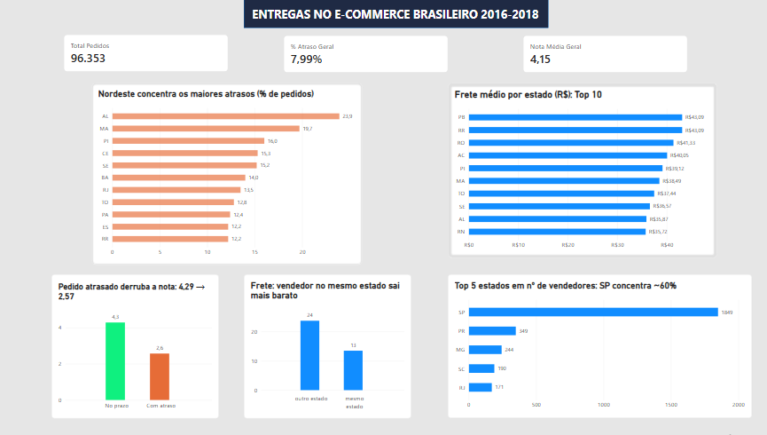

🇧🇷 Português | [🇪🇸 Español](README.es.md)

# Entregas no E-commerce Brasileiro (Olist, 2016-2018)

Análise de atrasos, frete e satisfação do cliente em pedidos do e-commerce brasileiro, com SQL para extração e agregação dos dados e Power BI para visualização.

   
   
## Pergunta de negócio
Onde as entregas atrasam mais, quanto o frete pesa em cada região e como o atraso afeta a nota dada pelo cliente?

## Principais achados
- Pedidos atrasados recebem nota média de **2,57**, contra **4,29** dos pontuais (queda de ~40%).
- **7,99%** dos pedidos chegam atrasados. Os maiores percentuais estão no Nordeste: AL (23,9%), MA (19,7%) e PI (16,0%), contra 5,9% em SP.
- O frete médio varia de **R$ 15,11 (SP)** a **R$ 43,09 (PB e RR)**.
- Quando o vendedor está no mesmo estado do cliente, o frete médio é **R$ 13,46**, contra **R$ 23,69** em outro estado (~43% menor).
- Cerca de **60% dos vendedores** estão em SP (1.849 de 3.095).

## Ferramentas
- **SQL**: limpeza, junção das tabelas e agregações
- **Power BI**: modelagem, medidas DAX e dashboard

## Estrutura do repositório
- `sql/`: consultas usadas para gerar as tabelas agregadas
- `data/`: tabelas agregadas (CSV) usadas no dashboard
- `images/`: imagem do dashboard
- `olist_entregas.pbix`: arquivo do Power BI (abrir no Power BI Desktop)

## Como usar
1. Baixe o arquivo `olist_entregas.pbix`.
2. Abra no Power BI Desktop (gratuito, apenas Windows).

## Fonte dos dados
Dataset público "Brazilian E-Commerce Public Dataset by Olist" (Kaggle).

## Autor
[TATIANE COUTINHO DE PAULA] · [https://www.linkedin.com/in/tatiane-de-paula-526609412]
